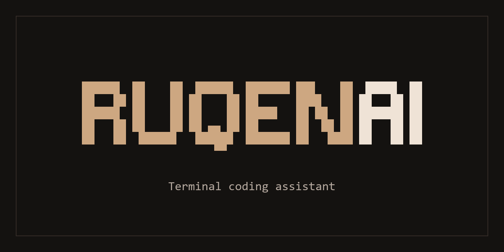
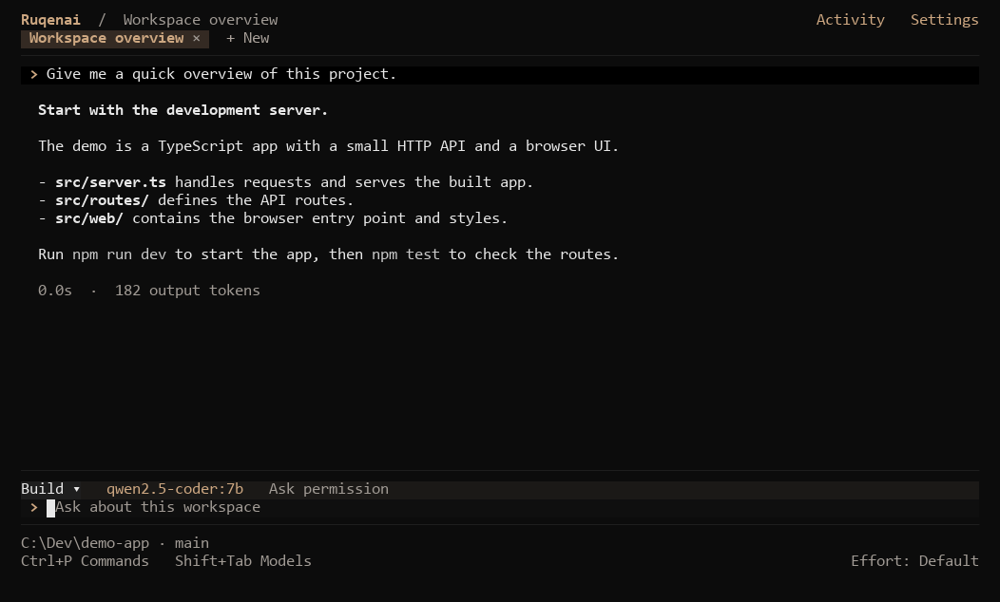
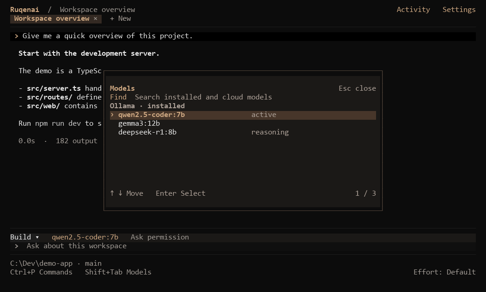

# Ruqenai



A terminal coding assistant for local Ollama models and cloud providers.

Ruqenai brings chat, workspace tools, and model selection into one terminal interface. Start a conversation in a project directory to give the assistant context for coding, exploring files, and running commands.

## What you can do

- Switch between installed Ollama models and configured cloud models from the model picker.
- Work across saved conversations with tabs and the session picker.
- Attach files and images to prompts, and review tool activity while the assistant works.
- Choose action permissions and reasoning effort for the current workflow.
- Connect MCP servers and use local skills, plugins, and agent profiles.
- Run a prompt directly from the command line when you do not need the interactive interface.

## Preview





## Start

### Install from npm

Once Ruqenai is published to npm, install it globally and launch it with:

```sh
npm install -g ruqenai
ruqenai
```

### Run from source

Install Node.js and npm, open a terminal in the project folder, and run:

```sh
npm install
npm start
```

To use the Windows launcher, run `npm run build` and then `.\ruqenai.cmd`. If the CLI is installed or linked, use `ruqenai`. For local models, start Ollama and install a model before selecting it in Ruqenai.

Each launch opens a fresh conversation with the Ruqenai wordmark. Use `/sessions` to find a saved conversation. Use `Ctrl+P` or `/help` to search commands. The model, access, activity, effort, and settings controls accept mouse clicks.

## Providers and models

1. Enter `/provider` and select a provider. Ollama uses `http://127.0.0.1:11434` by default or the address set with `OLLAMA_HOST`.
2. For a cloud provider, paste its API key into the masked field. For a custom OpenAI-compatible service, enter the API base URL and its key if required.
3. Use **Test connection** to check discovery, then **Save and view models**. Pick a model to use it for the next prompt.

`/model` groups installed Ollama models and configured cloud providers. Click the current model or press Tab in an empty prompt to open the same picker. Use `/provider` and select a provider to replace or remove its saved key.

The provider list contains **88 entries**. Of those, 32 provide chat connection profiles, including Ollama, native Anthropic and Gemini, NVIDIA NIM, other OpenAI-compatible services, and deployment profiles. The other 56 are catalog references. For deployment profiles such as Azure OpenAI, Bedrock, Vertex, Baseten, and RunPod, enter the base URL of your OpenAI-compatible deployment or gateway and its credentials. Use **Enter model ID** in the picker or `/model <provider> <model-id>` if the endpoint provides no model list.

To use NVIDIA NIM, enter `/provider nvidia` or set `NVIDIA_API_KEY` in your shell. Ruqenai uses NVIDIA’s hosted chat and model-list endpoints. Model availability depends on your NVIDIA account. [NVIDIA NIM API reference](https://docs.api.nvidia.com/nim/reference/llm-apis)

Keys saved in the provider picker go to `~/.ruqenai/.env`. Ruqenai migrates legacy keys from `~/.ruqenai/config.json` on startup. The Git ignore rules exclude dotenv files, local settings, and the private Obsidian vault.

Text attachments are sent as excerpts with the prompt. Images require a vision-capable model and use the selected provider's image format. If the provider rejects the first request, Ruqenai restores the draft and queues its attachments for retry.

`/effort` opens reasoning effort for the current model. Supported options include Off, Low, Medium, High, XHigh, and UltraCode. `/mode` opens **Ask permission**, **Approve for me**, and **Full access**.

`/settings` brings these controls together and includes a motion toggle. `/animations off` reduces motion and `/config show` prints settings with credentials and custom endpoints omitted.

## Keyboard

| Key | Action |
| --- | --- |
| `Ctrl+P` | Find a slash command |
| `Ctrl+V` / `Ctrl+Y` | Paste text or attach clipboard files and images on Windows. `/attach` reads the Windows clipboard directly. |
| `Ctrl+O` | Choose a model |
| `Ctrl+T` | Choose reasoning effort |
| `Ctrl+G` | Open or close activity |
| `Ctrl+R` | Show or hide provider reasoning |
| `Ctrl+U` | Open the effort picker, including UltraCode |
| `/` | Show matching commands above the prompt |
| `Tab` | Fill the highlighted command |
| `Esc` | Close a picker or cancel active work |
| `↑` / `↓` | Move in a picker or browse input history |
| `Page Up` / `Page Down` | Scroll the transcript |
| `Enter` | Send input or select a row |

## Tools and extensions

Use `/sessions` or `Ctrl+L` to switch saved chats. Wide terminals show chat tabs and a **+ New** button above the transcript. On Windows, use `/attach` to read the clipboard directly. Images require a vision-capable model. Text files are sent as excerpts.

- `/tools` lists tools. `/tools run <name> [json]` invokes one.
- `/skills` lists skills. Use `/skills create <name> <instructions>` to save a skill or `/skills run <name> <prompt>` to use it.
- `/agents` lists agent profiles. Use `/agents run <profile> <prompt>` to delegate a turn to a profile.
- `/mcp` lists configured servers. Use `/mcp <server>` to inspect its tools and `/mcp <server> <tool> [json]` to call one. The `mcpServers` object in `~/.ruqenai/mcp.json` maps each name to a local stdio `command` and optional `args`, `env`, and `description`.
- `/plugins` lists installed JSON manifests under `~/.ruqenai/plugins/`. Each may declare a `name`, a `description`, and a `mcpServers` object using the same format.

`/help all` prints the command list. Use `/attach <path>` to add file context, `/export <path>` to write a Markdown or JSON transcript, `/copy` to copy the latest response, or `/copy path` to copy the workspace path.

## Headless CLI

`ruqenai run` streams the answer to stdout and sends provider errors to stderr with a nonzero exit code.

Use `--profile <profile>` or `--skill <skill>` to set the instructions for one invocation. `--permission ask|approve|full` applies to that invocation, and `--yolo` is equivalent to `--permission full`.

```sh
ruqenai run "Explain event-driven architecture"
ruqenai run "Summarize this code" -p ollama -m qwen2.5:7b
ruqenai doctor
ruqenai models
ruqenai providers
```
